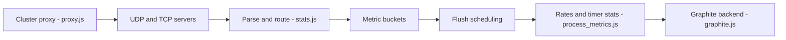

# statsd/statsd

> Node.js daemon that receives counters and timers over UDP/TCP and sends aggregates to Graphite.

## The problem
Measuring any application event without slowing the application down or creating metrics in advance.

## What it actually does
Receives `name:value|type` lines (for example `foo:1|c`), groups them by "bucket", then at each flush interval (10 s by default) computes rates and timer statistics and sends them to the backends (Graphite, console, repeater). TCP admin interface, name-hashing cluster proxy, namespaces.

## How it is wired


## Trying it
```bash
node stats.js /path/to/config
echo "foo:1|c" | nc -u -w0 127.0.0.1 8125
./run_tests.sh
```

## Cost and gotchas
Free. Requires Node.js and a config file derived from `exampleConfig.js`. Last push in May 2025 (over a year ago).

## What it is not
Not a storage or a dashboard: it aggregates then forwards. Values should preferably be integers.

## Alternatives
No alternative named in the README (Flickr's Perl StatsD is cited as inspiration).

## For you
Watch: a protocol still widespread for instrumenting code, but little activity; a recent agent can replace it.
