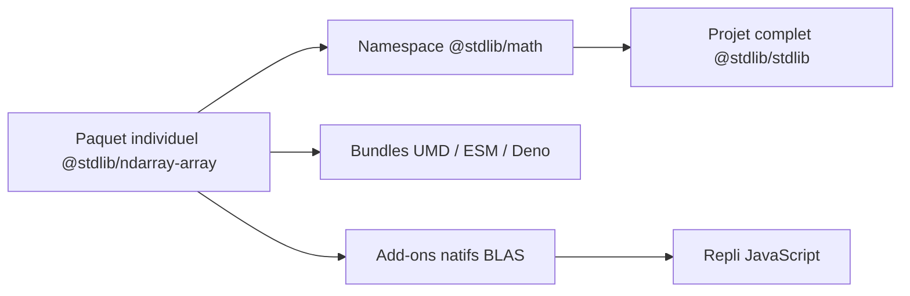

# stdlib-js/stdlib

> Standard library for numerical and scientific computing in JavaScript, for the browser and Node.js.

## The problem
Doing math, statistics and array manipulation in JavaScript forces you to assemble heterogeneous packages.

## What it actually does
Hundreds of independent npm packages: 150+ special math functions, 35+ probability distributions, 40+ pseudo-random generators, utilities, assertions, 50+ datasets, plotting APIs, ndarray, a REPL. Native implementations (C, BLAS) fall back to pure JavaScript. Each package ships its own TypeScript declarations.

## How it is wired


## Trying it
```bash
npm install @stdlib/stdlib
npm install @stdlib/ndarray-array
npm install -g @stdlib/stdlib
stdlib repl
```

## Cost and gotchas
Free. Installing the whole project is slow: the README recommends individual packages. Native add-ons require make, gcc/g++, gfortran; otherwise it falls back to JavaScript. The README is truncated in places (empty status table, badly rendered Node prerequisite line).

## What it is not
Not a complete equivalent of the Python ecosystem (the README compares itself to Python, Julia, R, MATLAB for data analysis but gives no figures). The advertised performance is not measured in the README.

## Alternatives
No repository is named as an alternative in the README.

## For you
Worth watching: useful if you need to compute in the browser or Node (demos, dashboards), pointless if your pipeline stays in Python.
