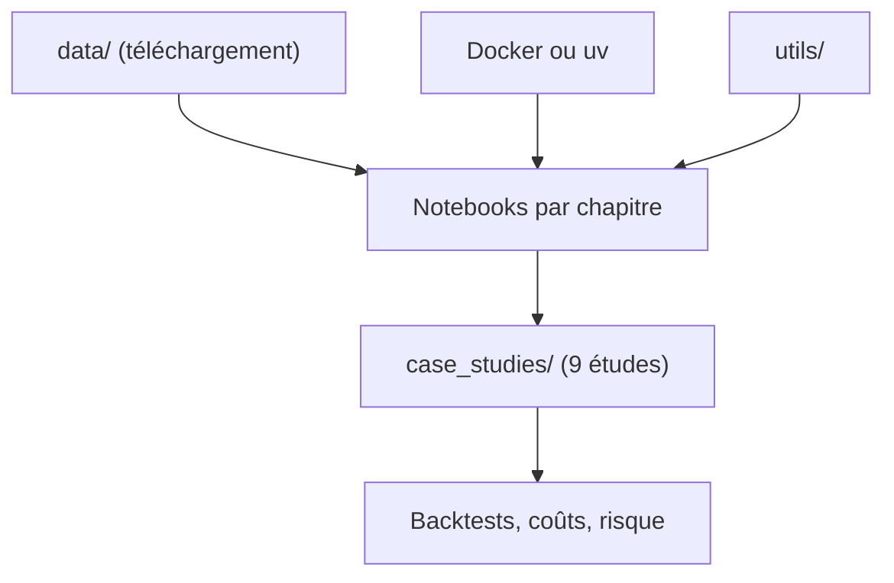

# stefan-jansen/machine-learning-for-trading

> Code for the 3rd edition of the book on ML for trading, from data to real execution.

## The problem
Financial ML backtests are often invalidated by data leakage and overfitting.

## What it actually does
27 chapters of notebooks (Jupytext) and nine case studies on ETFs, crypto, equities, options, FX, futures. Covers data, labels, models (boosting, deep time series, causal, RL, RAG, agents), backtests, costs, risk, production and MLOps. Six `ml4t-*` libraries come with it, plus agent skills.

## How it is wired


## Trying it
```bash
git clone https://github.com/stefan-jansen/machine-learning-for-trading.git
cd machine-learning-for-trading
cp .env.example .env
docker compose pull ml4t
uv sync
uv run python data/download_all.py --free-only
uv run python scripts/verify_installation.py
```

## Cost and gotchas
About 16 GB of disk, 4 GB of free data. GPU for the deep-learning chapters. Some data requires licenses or keys. Windows: WSL2 only. Paid courses are offered alongside.

## What it is not
Not a complete book: the text is not in the repository. No guarantee of profitability. The provided diagram describes the 2nd edition, not this one.

## Alternatives
No alternative named in the README.

## For you
Adopt it as a methodological reference (walk-forward validation, Deflated Sharpe): rigor that carries over beyond finance.
