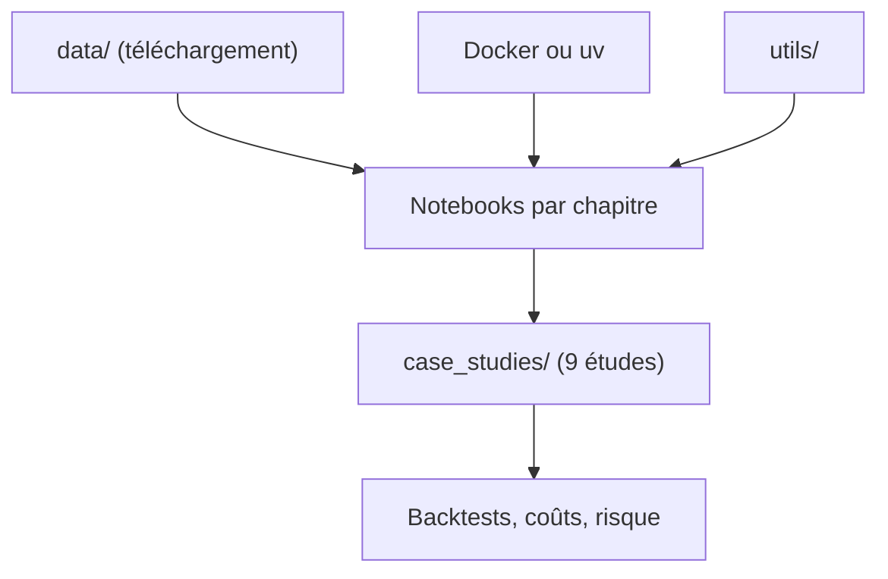

# stefan-jansen/machine-learning-for-trading

> Code de la 3e édition du livre sur le ML pour le trading, de la donnée à l'exécution réelle.

## Le problème
Les backtests de ML financier sont souvent invalidés par la fuite de données et le surapprentissage.

## Ce que ça fait vraiment
27 chapitres de notebooks (Jupytext) et neuf études de cas sur ETF, crypto, actions, options, FX, futures. Couvre données, étiquettes, modèles (boosting, séries temporelles profondes, causal, RL, RAG, agents), backtests, coûts, risque, production et MLOps. Six bibliothèques `ml4t-*` accompagnent, plus des skills d'agents.

## Comment c'est branché


## Essayer
```bash
git clone https://github.com/stefan-jansen/machine-learning-for-trading.git
cd machine-learning-for-trading
cp .env.example .env
docker compose pull ml4t
uv sync
uv run python data/download_all.py --free-only
uv run python scripts/verify_installation.py
```

## Coût et pièges
Environ 16 Go de disque, 4 Go de données gratuites. GPU pour les chapitres profonds. Certaines données exigent des licences ou clés. Windows : WSL2 seulement. Cours payants proposés en parallèle.

## Ce que ce n'est pas
Pas un livre complet : le texte n'est pas dans le dépôt. Pas de garantie de rentabilité. Le diagramme fourni décrit la 2e édition, pas celle-ci.

## Alternatives
Aucune alternative nommée dans le README.

## Pour toi
Adopter comme référence de méthode (validation walk-forward, Deflated Sharpe) : rigueur transposable au-delà de la finance.

