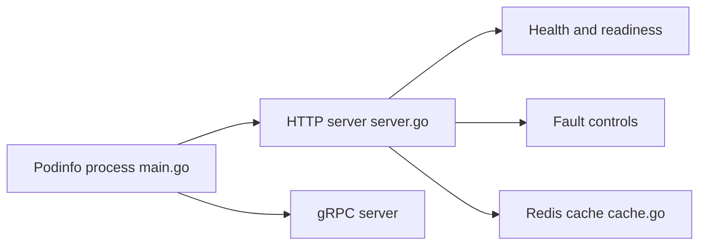

# stefanprodan/podinfo

> Small Go service serving as a demo and test target for Kubernetes microservice best practices.

## The problem
Testing a deployment, a probe or a canary requires a realistic, harmless application.

## What it actually does
Exposes HTTP and gRPC routes: runtime information, `/healthz`, `/readyz`, `/metrics`, fault and latency injection, JWT, Redis cache, disk storage, echo to a backend, websocket and Swagger. Deploys with Timoni, Helm, Kustomize or Docker. Used by Flux and Flagger for testing.

## How it is wired


## Trying it
```bash
docker run -dp 9898:9898 stefanprodan/podinfo
helm repo add podinfo https://stefanprodan.github.io/podinfo
kubectl apply -k github.com/stefanprodan/podinfo//kustomize
```

## Cost and gotchas
Free; Kubernetes 1.23+ minimum for cluster installation. The `/panic` and `/fault_injection/*` routes are deliberately destructive.

## What it is not
Not a business application: a dummy demo workload.

## Alternatives
No alternative named in the README.

## For you
Worth watching: serves as a test target for MLOps deployments (canary, GitOps), but will only be useful on clusters.
