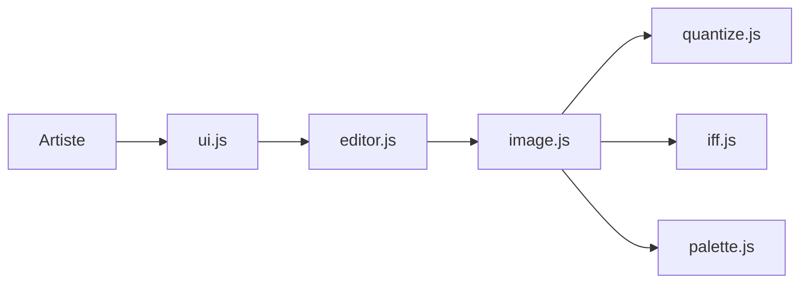

# steffest/DPaint-js

> Web image editor inspired by Deluxe Paint, geared toward retro Amiga formats.

## The problem
Amiga formats (IFF ILBM, icons, ADF) no longer have modern tools to read or produce them.

## What it actually does
Pure JavaScript editor with no dependencies, running in the browser: layers, selections, dithering, palette reduction (12-bit OCS, 9-bit Atari ST), color cycling, frame-by-frame animation. Reads and writes IFF ILBM/ANIM, Amiga icons and ADF disks, with a built-in Amiga emulator (files not included).

## How it is wired


## Trying it
```bash
npx serve
npm install
npm run build
```
The online version is at dpaint.app; `index.html` must be served from a web server.

## Cost and gotchas
Free, no account and no tracking. The Brave browser disrupts rendering (farbling).

## What it is not
Not an application to install; not a professional photo-retouching tool.

## Alternatives
No alternative cited in the README.

## For you
Ignore: retro pixel-art tool, unrelated to data, AI or MLOps, although its color quantization is documented.
