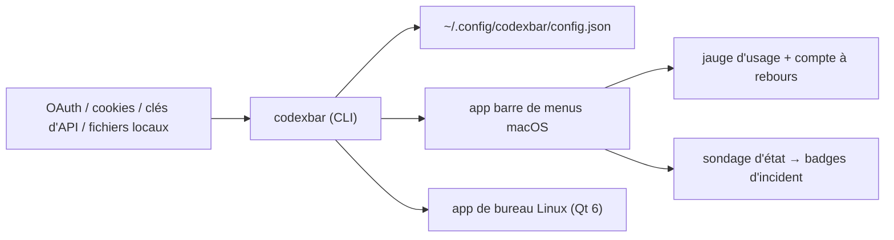

# steipete/CodexBar

> Menu bar app that shows the quotas and spending of its AI providers.

## The problem
Each AI provider has its own quota window, reset time and dashboard:
you discover the limit at the moment you need it most.

## What it actually does
One menu bar item per provider (or a merged mode with a selector), showing session,
weekly and monthly windows with a countdown to reset, credit balances, spending charts and
local cost analyses. More than sixty providers covered.
Authentication reuses what already exists: OAuth, device flow, API keys, browser
cookies, local files. A `codexbar` CLI handles configuration and serves scripts and CI.
macOS and Linux (Qt 6) versions, plus an Omarchy widget.

## How it is wired


## Trying it
```bash
brew install --cask codexbar
brew install steipete/tap/codexbar
codexbar config providers
codexbar config enable --provider grok
printf '%s' "$ELEVENLABS_API_KEY" | codexbar config set-api-key --provider elevenlabs --stdin
```

## Cost and gotchas
macOS 14+ or Linux with glibc 2.39+ and Qt 6.4+. Full disk access is only required to read
Safari cookies; importing Chromium cookies requires the keychain. The "Adaptive
(agent-aware)" option asks for permission before inspecting the list of running processes, command
line included. Tokens live in the configuration file, with restricted permissions.

## What it is not
Not a cost-control tool: it shows, it limits nothing. Not a service: everything is read
locally, no password is stored. Not exhaustive on your behalf: each provider requires its
own authentication source, to be installed and connected one by one.

## Alternatives
- `ccusage`: credited as the inspiration for cost tracking.
- Win-CodexBar / CodexBar for Windows: the named Windows ports.

## For you
Pure comfort; useful if you juggle several agent subscriptions, useless otherwise.
