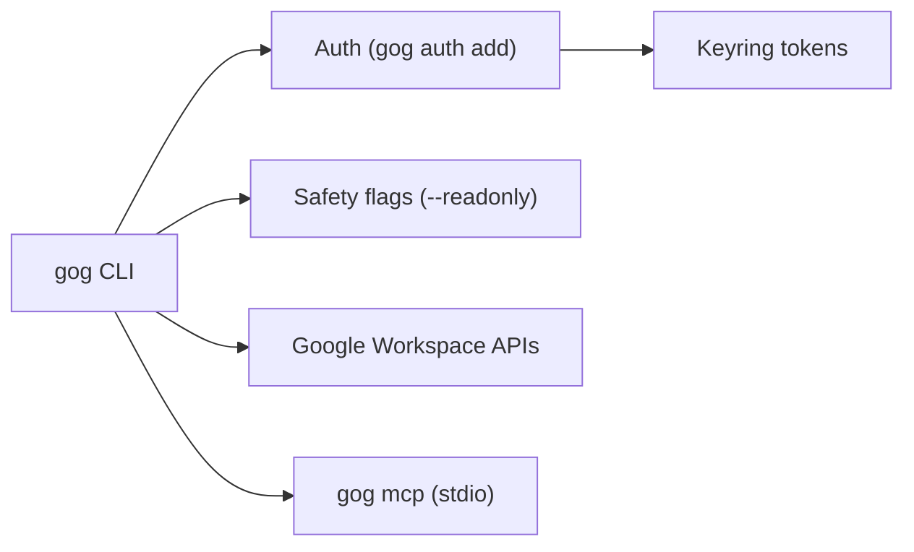

# steipete/gogcli

> Single command-line client for Gmail, Calendar, Drive, Docs and Sheets, designed for scripts and agents.

## The problem
Automating Google Workspace means assembling several APIs, OAuth and output formats, with no safeguards when an agent uses it.

## What it actually does
- Commands per resource: `gog gmail`, `calendar`, `drive`, `docs`, `sheets`, `slides`, `admin`, etc., with fallback to the Discovery API.
- `--json` or `--plain` (TSV) output, prompts on stderr.
- Safeguards: `--readonly`, exact list of allowed commands, `--gmail-no-send`, `--wrap-untrusted`.
- Multiple accounts with aliases, tokens in the system keyring; MCP server over stdio, read-only by default.

## How it is wired
No code diagram provided; diagram based on the README.


## Trying it
```bash
brew install openclaw/tap/gogcli
gog auth credentials set ~/Downloads/client_secret_*.json
gog auth add you@gmail.com --services gmail,calendar,drive
gog auth doctor --check
gog --readonly gmail search 'newer_than:7d' --max 10 --json
```

## Cost and gotchas
Free, but you must create a Desktop OAuth client in a Google Cloud project. Administration (Directory, Groups, Chat, Keep) requires a managed Workspace domain. The Go module moved from `steipete/gogcli` to `openclaw/gogcli`.

## What it is not
Not affiliated with Google. Not a zero-configuration tool: OAuth authorization and API activation come before any use. Not a "generic" connector: only Google APIs are covered.

## Alternatives
The README cites gmcli, gccli and gdcli by Mario Zechner as inspirations.

## For you
Watch: very useful if your agents read Gmail, Calendar or Drive, thanks to the read-only and allowlist modes; useless without Google Workspace.
