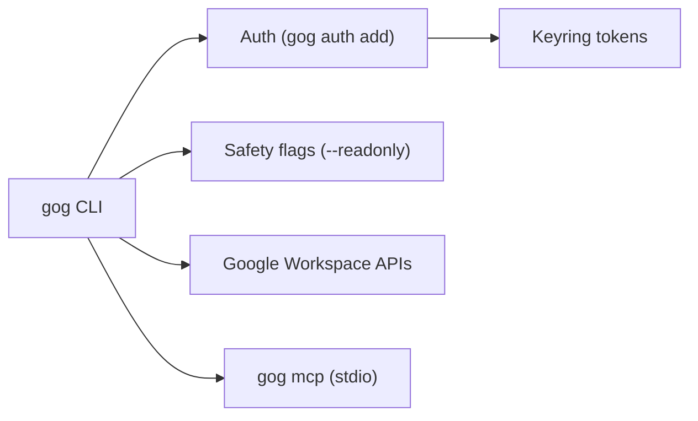

# steipete/gogcli

> Client en ligne de commande unique pour Gmail, Agenda, Drive, Docs et Sheets, pensé pour scripts et agents.

## Le problème
Automatiser Google Workspace demande d'assembler plusieurs API, OAuth et formats de sortie, sans garde-fous quand un agent s'en sert.

## Ce que ça fait vraiment
- Commandes par ressource : `gog gmail`, `calendar`, `drive`, `docs`, `sheets`, `slides`, `admin`, etc., avec repli sur l'API Discovery.
- Sortie `--json` ou `--plain` (TSV), invites sur stderr.
- Garde-fous : `--readonly`, liste exacte de commandes autorisées, `--gmail-no-send`, `--wrap-untrusted`.
- Plusieurs comptes avec alias, jetons dans le trousseau système ; serveur MCP en stdio, lecture seule par défaut.

## Comment c'est branché
Aucun diagramme du code fourni ; schéma d'après le README.


## Essayer
```bash
brew install openclaw/tap/gogcli
gog auth credentials set ~/Downloads/client_secret_*.json
gog auth add you@gmail.com --services gmail,calendar,drive
gog auth doctor --check
gog --readonly gmail search 'newer_than:7d' --max 10 --json
```

## Coût et pièges
Gratuit, mais il faut créer un client OAuth Desktop dans un projet Google Cloud. L'administration (Directory, Groupes, Chat, Keep) exige un domaine Workspace géré. Le module Go est passé de `steipete/gogcli` à `openclaw/gogcli`.

## Ce que ce n'est pas
Pas affilié à Google. Pas un outil sans configuration : l'autorisation OAuth et l'activation des API précèdent tout usage. Pas un connecteur « générique » : seules les API Google sont couvertes.

## Alternatives
Le README cite comme inspirations gmcli, gccli et gdcli de Mario Zechner.

## Pour toi
À surveiller : très utile si tes agents lisent Gmail, Agenda ou Drive, grâce aux modes lecture seule et liste d'autorisations ; inutile sans Google Workspace.

