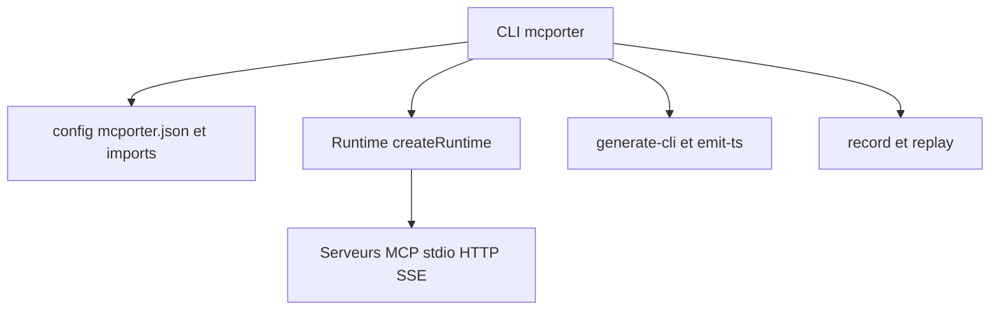

# steipete/mcporter

> TypeScript runtime and CLI to discover and call MCP servers from a terminal, a script or an agent.

## The problem
Using an MCP server's tools outside a dedicated client requires custom connection code.

## What it actually does
`mcporter list` shows a server's tools with their signatures, `mcporter call` calls them. It imports configurations from Cursor, Claude, Codex, Windsurf, OpenCode and VS Code, handles OAuth with an encryptable vault, and generates CLIs or TypeScript clients. It can record and replay sessions. Protocols: stdio, Streamable HTTP, SSE.

## How it is wired
Simplified diagram based on the sheet, no diagram provided.



## Trying it
```sh
npx mcporter list https://mcp.context7.com/mcp --brief
npx mcporter call https://mcp.context7.com/mcp.resolve-library-id query="React hooks docs" libraryName=react
npm install -g mcporter
```

## Cost and gotchas
Free, MIT, Node 24+ for npm. Remote MCP servers may require OAuth or their own key. Only 3 open issues, last push on 2026-11-05.

## What it is not
It is not an MCP server: it consumes existing ones. It is not an agent, and the README presents no graphical interface.

## Alternatives
No alternative named in the README.

## For you
Worth adopting if you script or test MCP tools: it saves rewriting the connection and generates typed clients, to be verified against your own servers.
