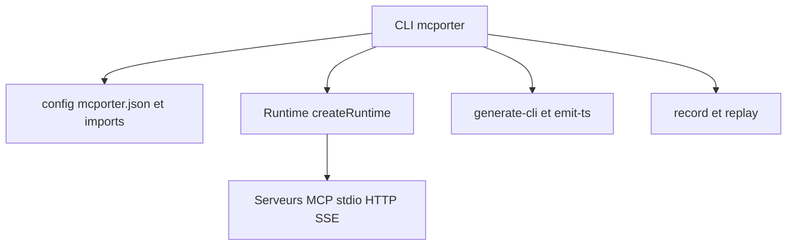

# steipete/mcporter

> Runtime et CLI TypeScript pour découvrir et appeler des serveurs MCP depuis un terminal, un script ou un agent.

## Le problème
Utiliser les outils d'un serveur MCP hors d'un client dédié demande du code de connexion sur mesure.

## Ce que ça fait vraiment
`mcporter list` montre les outils d'un serveur avec leurs signatures, `mcporter call` les appelle. Il importe les configurations de Cursor, Claude, Codex, Windsurf, OpenCode et VS Code, gère OAuth avec un coffre chiffrable, et génère des CLI ou des clients TypeScript. Il sait enregistrer et rejouer des sessions. Protocoles : stdio, Streamable HTTP, SSE.

## Comment c'est branché
Schéma simplifié d'après la fiche, sans diagramme fourni.



## Essayer
```sh
npx mcporter list https://mcp.context7.com/mcp --brief
npx mcporter call https://mcp.context7.com/mcp.resolve-library-id query="React hooks docs" libraryName=react
npm install -g mcporter
```

## Coût et pièges
Gratuit, MIT, Node 24+ pour npm. Les serveurs MCP distants peuvent exiger OAuth ou une clé propre. Seulement 3 issues ouvertes, dernier push le 2026-11-05.

## Ce que ce n'est pas
Ce n'est pas un serveur MCP : il consomme ceux qui existent. Ce n'est pas un agent, et le README ne présente pas d'interface graphique.

## Alternatives
Aucune alternative nommée dans le README.

## Pour toi
À adopter si tu scriptes ou testes des outils MCP : il évite de réécrire la connexion et génère des clients typés, à vérifier sur tes serveurs.

