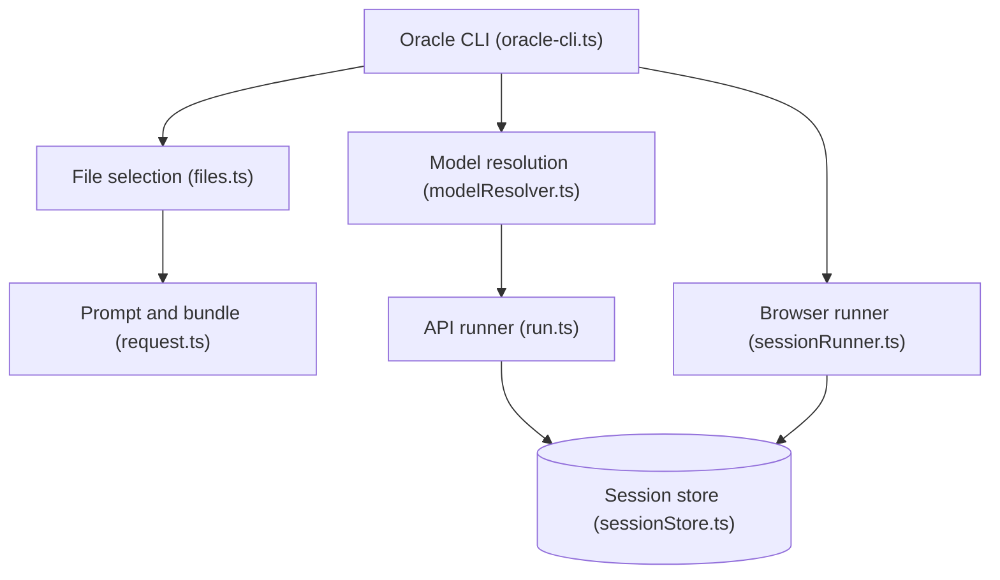

# steipete/oracle

> CLI and MCP server that send a prompt and chosen files to a second model for review.

## The problem
Asking another model for a second opinion forces you to copy the project context by hand.

## What it actually does
Assembles a prompt and the selected files (globs, exclusions, line numbers), then sends it via API (OpenAI, Azure, Anthropic, Gemini, xAI, OpenRouter) or via a Chrome browser logged into ChatGPT or Gemini. Records each run as a session (`~/.oracle/sessions`), which can be replayed or extended. Several models can be queried at once.

## How it is wired


## Trying it
```bash
npm install -g @steipete/oracle
oracle --render -p "Review the package metadata for release risks" --file package.json
oracle status --hours 72
```

## Cost and gotchas
Node.js 24 or later. API mode is billed on your key; browser mode requires a logged-in account and Chrome. `--render` works without credentials.

## What it is not
It is not a coding agent: it provides a review, it modifies nothing. The files sent leave your machine for the chosen provider.

## Alternatives
No alternative named in the README.

## For you
Adopt it to get a second model opinion on code or a review, keeping an eye on what goes to the provider.
