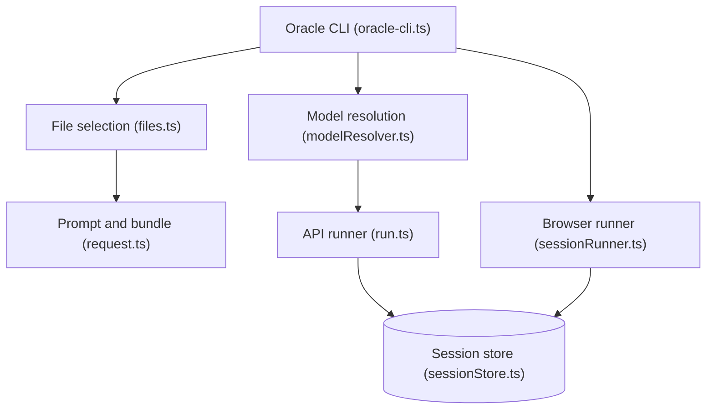

# steipete/oracle

> CLI et serveur MCP qui envoient prompt et fichiers choisis à un second modèle pour relecture.

## Le problème
Demander un second avis à un autre modèle oblige à recopier à la main le contexte du projet.

## Ce que ça fait vraiment
Assemble un prompt et les fichiers sélectionnés (globs, exclusions, numéros de ligne), puis l'envoie via API (OpenAI, Azure, Anthropic, Gemini, xAI, OpenRouter) ou via un navigateur Chrome connecté à ChatGPT ou Gemini. Enregistre chaque run en session (`~/.oracle/sessions`), rejouable ou prolongeable. Plusieurs modèles peuvent être interrogés en une fois.

## Comment c'est branché


## Essayer
```bash
npm install -g @steipete/oracle
oracle --render -p "Review the package metadata for release risks" --file package.json
oracle status --hours 72
```

## Coût et pièges
Node.js 24 ou plus. Le mode API est facturé sur ta clé ; le mode navigateur exige un compte connecté et Chrome. `--render` fonctionne sans identifiant.

## Ce que ce n'est pas
Ce n'est pas un agent de code : il fournit une relecture, il ne modifie rien. Les fichiers envoyés quittent ta machine vers le fournisseur choisi.

## Alternatives
Aucune alternative nommée dans le README.

## Pour toi
À adopter pour obtenir un deuxième avis de modèle sur du code ou une revue, en gardant un œil sur ce qui part chez le fournisseur.

