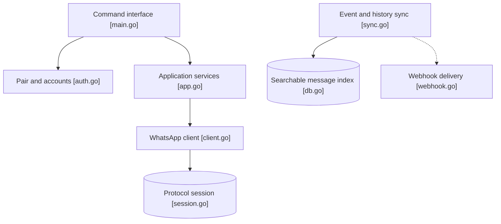

# steipete/wacli

> Scriptable command-line WhatsApp client that mirrors your messages into a local SQLite database.

## The problem
WhatsApp has no scriptable interface: impossible to search, export or automate sending from a terminal or a script.

## What it actually does
Pairs as a linked device via the WhatsApp Web protocol (whatsmeow). Syncs history into an offline-searchable SQLite index, sends text and files, manages groups, contacts and profiles. `--json` or `--events` (NDJSON) outputs, read-only mode, named accounts, webhooks.

## How it is wired


## Trying it
```bash
brew install openclaw/tap/wacli
wacli auth
wacli messages search "meeting"
wacli send text --to +15551234567 --message "hello"
wacli sync --follow
```

## Cost and gotchas
Free, but you need a WhatsApp account and must scan a QR code. Building from source: Go 1.27+ and a C compiler. History is provided "best effort" by WhatsApp Web.

## What it is not
Not affiliated with WhatsApp or Meta: it relies on an unofficial protocol, so it is exposed to breakage or account restriction (inferred risk, not documented). It is not the official Business API.

## Alternatives
`whatsapp-cli` by Vicente Reig (cited source of inspiration); otherwise none cited.

## For you
Keep an eye on it: handy for plugging your messages into an agent or a local pipeline, but it depends on an unofficial protocol and is maintained by one person.
