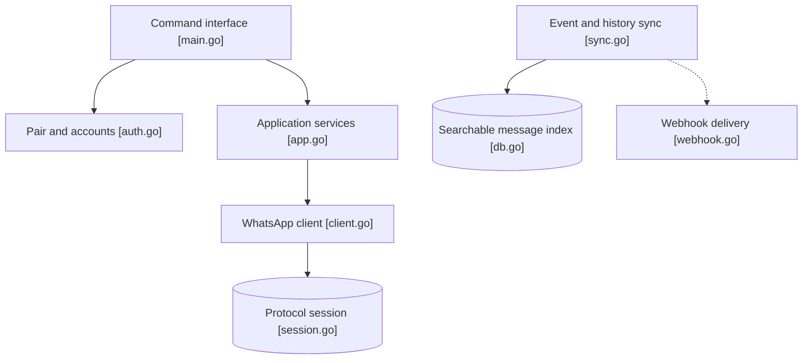

# steipete/wacli

> Client WhatsApp en ligne de commande, scriptable, qui miroite tes messages dans une base SQLite locale.

## Le problème
WhatsApp n'a pas d'interface scriptable : impossible de chercher, exporter ou automatiser l'envoi depuis un terminal ou un script.

## Ce que ça fait vraiment
Se jumelle comme appareil lié via le protocole WhatsApp Web (whatsmeow). Synchronise l'historique dans un index SQLite cherchable hors ligne, envoie texte et fichiers, gère groupes, contacts et profils. Sorties `--json` ou `--events` (NDJSON), mode lecture seule, comptes nommés, webhooks.

## Comment c'est branché


## Essayer
```bash
brew install openclaw/tap/wacli
wacli auth
wacli messages search "meeting"
wacli send text --to +15551234567 --message "hello"
wacli sync --follow
```

## Coût et pièges
Gratuit, mais il faut un compte WhatsApp et scanner un QR code. Compilation depuis les sources : Go 1.27+ et un compilateur C. L'historique est fourni « au mieux » par WhatsApp Web.

## Ce que ce n'est pas
Non affilié à WhatsApp ni Meta : il repose sur un protocole non officiel, donc exposé à une rupture ou à une restriction de compte (risque déduit, non documenté). Ce n'est pas l'API Business officielle.

## Alternatives
`whatsapp-cli` de Vicente Reig (source d'inspiration citée) ; sinon aucune autre citée.

## Pour toi
Surveiller : pratique pour brancher tes messages à un agent ou un pipeline local, mais dépendance à un protocole non officiel et maintenance par une personne.

