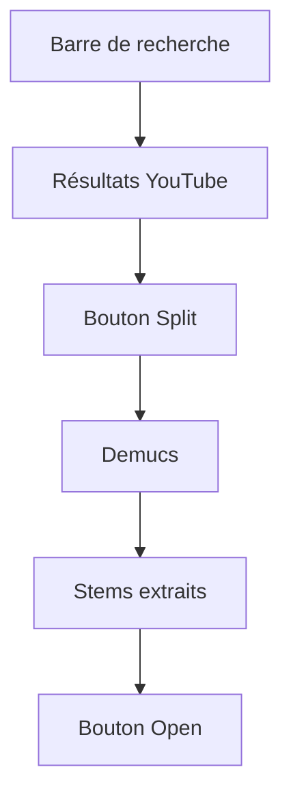

# stemrollerapp/stemroller

> Free desktop application that separates vocals and instruments from a track with Demucs.

## The problem
Isolating the vocals and instruments of a track requires handling separation models on the command line.

## What it actually does
You type a title, the application searches YouTube, you click Split and Demucs separates the tracks; allow several minutes. An Open button gives access to the stems. The downloaded bundle contains everything needed; the project is developed with npm and Svelte.

## How it is wired
Simplified diagram based on the sheet, no diagram provided.


## Trying it
```bash
git clone https://github.com/stemrollerapp/stemroller.git
cd stemroller
npm i -D
npm run dev
```

## Cost and gotchas
Free. A license is present but not identified by GitHub: read it before reuse. Splitting takes several minutes per track. Downloads of third-party components are provided for Windows and macOS.

## What it is not
Not an audio separation library: it is a graphical application. No details on the required hardware in this README. The rights to the processed tracks remain your business.

## Alternatives
No alternative named in the README, apart from Demucs, which it embeds.

## For you
To ignore: a consumer application built around Demucs; for audio processing in a pipeline, go through Demucs directly instead.
