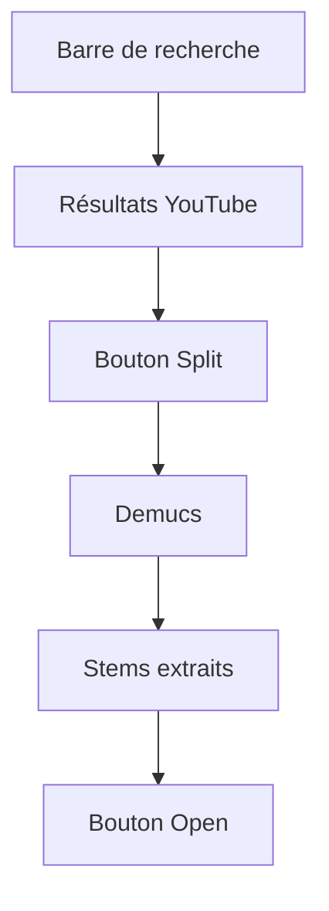

# stemrollerapp/stemroller

> Application de bureau gratuite qui sépare voix et instruments d'un morceau avec Demucs.

## Le problème
Isoler la voix et les instruments d'un morceau demande de manipuler des modèles de séparation en ligne de commande.

## Ce que ça fait vraiment
Tu tapes un titre, l'application cherche sur YouTube, tu cliques sur Split et Demucs sépare les pistes ; compte plusieurs minutes. Un bouton Open donne accès aux stems. Le bundle téléchargé contient tout le nécessaire ; le projet se développe avec npm et Svelte.

## Comment c'est branché
Schéma simplifié d'après la fiche, sans diagramme fourni.


## Essayer
```bash
git clone https://github.com/stemrollerapp/stemroller.git
cd stemroller
npm i -D
npm run dev
```

## Coût et pièges
Gratuit. Licence présente mais non identifiée par GitHub : à lire avant réutilisation. Le découpage prend plusieurs minutes par titre. Les téléchargements de composants tiers sont prévus pour Windows et macOS.

## Ce que ce n'est pas
Pas une bibliothèque de séparation audio : c'est une application graphique. Pas de précision sur le matériel requis dans ce README. Les droits des morceaux traités restent ton affaire.

## Alternatives
Aucune alternative nommée dans le README, hors Demucs qu'il embarque.

## Pour toi
À ignorer : application grand public autour de Demucs ; pour du traitement audio en pipeline, passe plutôt par Demucs directement.

