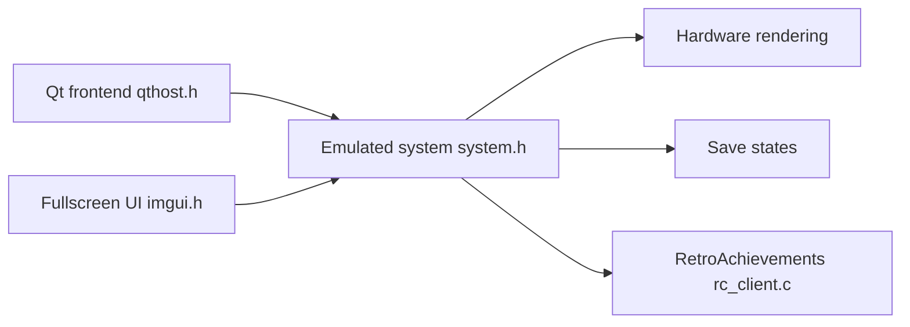

# stenzek/duckstation

> PlayStation 1 emulator for Windows, Linux, macOS and Android, focused on accuracy and performance.

## The problem
Replaying PS1 games on a PC or phone with decent fidelity and better rendering than the original console.

## What it actually does
Emulator with a CPU recompiler, hardware rendering (D3D11/12, OpenGL, Vulkan, Metal), PGXP, upscaling, save states, cheats, RetroAchievements. Two interfaces: Qt and an ImGui fullscreen one. A user-supplied PS1/PS2 BIOS is mandatory.

## How it is wired


## Trying it
```bash
chmod a+x DuckStation-x64.AppImage
git clone https://github.com/stenzek/duckstation.git
```

## Cost and gotchas
Free, but the BIOS is not provided (it must be extracted from your own console). No support for the Android app. Recent Windows installer.

## What it is not
Not free in the strict sense: the README cites CC-BY-NC-ND, which only allows unmodified redistribution. One main maintainer.

## Alternatives
No alternative named in the README.

## For you
Ignore: a game emulator unrelated to data/AI/MLOps, with a restrictive license.
