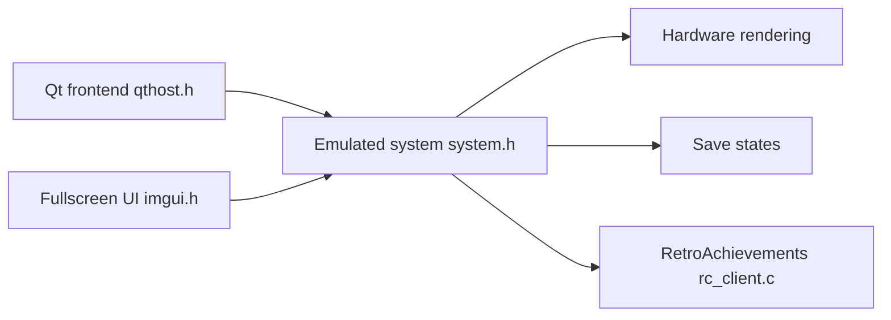

# stenzek/duckstation

> Émulateur PlayStation 1 pour Windows, Linux, macOS et Android, axé précision et performance.

## Le problème
Rejouer des jeux PS1 sur PC ou mobile avec une fidélité correcte et de meilleurs rendus que la console.

## Ce que ça fait vraiment
Émulateur avec recompilateur CPU, rendu matériel (D3D11/12, OpenGL, Vulkan, Metal), PGXP, mise à l'échelle, états sauvegardés, cheats, RetroAchievements. Deux interfaces : Qt et plein écran ImGui. Un BIOS PS1/PS2 fourni par l'utilisateur est obligatoire.

## Comment c'est branché


## Essayer
```bash
chmod a+x DuckStation-x64.AppImage
git clone https://github.com/stenzek/duckstation.git
```

## Coût et pièges
Gratuit, mais le BIOS n'est pas fourni (à extraire de sa console). Aucun support pour l'application Android. Installeur Windows récent.

## Ce que ce n'est pas
Pas libre au sens strict : le README cite CC-BY-NC-ND, qui n'autorise que la redistribution non modifiée. Un mainteneur principal.

## Alternatives
Aucune alternative nommée dans le README.

## Pour toi
À ignorer : un émulateur de jeux sans rapport avec la data/IA/MLOps, et une licence restrictive.

