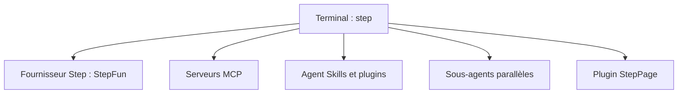

# stepfun-ai/Step-Code

> StepFun's terminal coding agent, wired to its models, compatible with Claude Code plugins.

## The problem
Terminal coding agents are often tied to one model provider; one is needed that makes good use of the Step models and limits token consumption.

## What it actually does
Reads code, edits files and runs tests from the terminal. Supports MCP, Agent Skills, plugins and parallel sub-agents. `/goal` delegates a long task, `/cron` schedules. Publishes a static page through the StepPage plugin. Imports the MCP config of Claude Code and Codex.

## How it is wired
Simplified diagram based on the sheet, no diagram provided.


## Trying it
```bash
curl -fsSL https://static-openapi.stepfun.com/stepcode/install.sh | bash
step login
cd /path/to/your/project
step
step -p "What is the tech stack of this project?"
```

## Cost and gotchas
Log in with a Step Plan account (subscription included) or a Step Platform API key (pay per request). StepPage requires Node.js 20 or later. Windows is still in beta.

## What it is not
It is not a model: without a Step account, nothing runs. No choice of other providers: only one is built in.

## Alternatives
No alternative named, apart from Claude Code and Codex cited for migration.

## For you
Worth watching: useful if you want to test the Step models with your skills and MCP servers, but you stay locked into a single provider.
