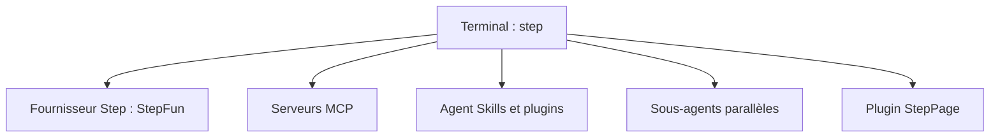

# stepfun-ai/Step-Code

> Agent de code en terminal de StepFun, branché sur ses modèles, compatible avec les plugins Claude Code.

## Le problème
Les agents de code en terminal sont souvent liés à un fournisseur de modèles ; il en faut un qui exploite bien les modèles Step et en limite la consommation de jetons.

## Ce que ça fait vraiment
Lit le code, modifie des fichiers et lance des tests depuis le terminal. Gère MCP, Agent Skills, plugins et sous-agents parallèles. `/goal` délègue une tâche longue, `/cron` planifie. Publie une page statique via le plugin StepPage. Importe la config MCP de Claude Code et Codex.

## Comment c'est branché
Schéma simplifié d'après la fiche, sans diagramme fourni.


## Essayer
```bash
curl -fsSL https://static-openapi.stepfun.com/stepcode/install.sh | bash
step login
cd /path/to/your/project
step
step -p "What is the tech stack of this project?"
```

## Coût et pièges
Connexion à un compte Step Plan (forfait inclus) ou clé d'API Step Platform (paiement à la requête). StepPage demande Node.js 20 ou plus. Windows reste en bêta.

## Ce que ce n'est pas
Ce n'est pas un modèle : sans compte Step, rien ne tourne. Pas de choix d'autres fournisseurs : un seul est intégré.

## Alternatives
Aucune alternative nommée, hormis Claude Code et Codex cités pour la migration.

## Pour toi
À surveiller : utile si tu veux tester les modèles Step avec tes skills et tes serveurs MCP, mais tu restes enfermé dans un seul fournisseur.

