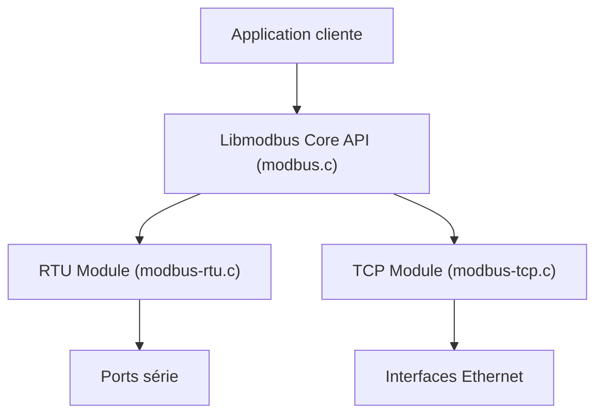

# stephane/libmodbus

> C library for talking to Modbus devices over serial port or Ethernet.

## The problem
Speaking Modbus to a PLC or an industrial sensor means implementing the protocol by hand, frame by frame.

## What it actually does
A generic core (src/modbus.c) relies on two modules, RTU for serial (modbus-rtu.c) and TCP for Ethernet (modbus-tcp.c). The library runs on Linux, Mac OS X, FreeBSD, Embox, QNX and Windows. It provides a libmodbus.pc file for pkg-config, client and server tests, and documentation served by mkdocs.

## How it is wired


## Trying it
```bash
./autogen.sh
./configure && make install
./unit-test-server
./unit-test-client
```

## Cost and gotchas
Free. You need automake, autoconf, libtool and a C compiler. On Windows, MinGW or a Visual C project.

## What it is not
It is not a ready-to-use tool: it is a C building block to link into your program. LGPL 2.1 license: dynamic linking advised for closed-source code.

## Alternatives
No alternative named in the README.

## For you
Worth watching: useful if your data comes from industry (sensors, PLCs), useless for a classic AI pipeline.
