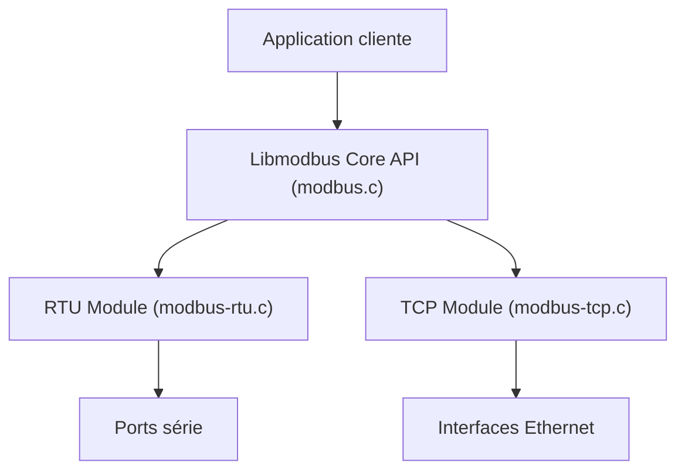

# stephane/libmodbus

> Bibliothèque C pour dialoguer avec des équipements Modbus par port série ou Ethernet.

## Le problème
Parler Modbus à un automate ou un capteur industriel suppose d'implémenter le protocole à la main, trame par trame.

## Ce que ça fait vraiment
Un cœur générique (src/modbus.c) s'appuie sur deux modules, RTU pour le série (modbus-rtu.c) et TCP pour Ethernet (modbus-tcp.c). La bibliothèque tourne sur Linux, Mac OS X, FreeBSD, Embox, QNX et Windows. Elle fournit un fichier libmodbus.pc pour pkg-config, des tests client et serveur, et une documentation servie par mkdocs.

## Comment c'est branché


## Essayer
```bash
./autogen.sh
./configure && make install
./unit-test-server
./unit-test-client
```

## Coût et pièges
Gratuit. Il faut automake, autoconf, libtool et un compilateur C. Sous Windows, MinGW ou un projet Visual C.

## Ce que ce n'est pas
Ce n'est pas un outil prêt à l'emploi : c'est une brique C à lier dans ton programme. Licence LGPL 2.1 : liaison dynamique conseillée pour du code fermé.

## Alternatives
Aucune alternative nommée dans le README.

## Pour toi
Surveiller : utile si tes données viennent de l'industrie (capteurs, automates), inutile pour un pipeline IA classique.

