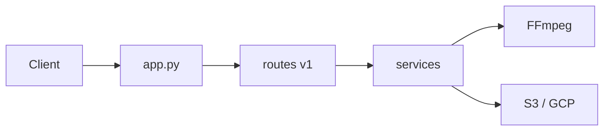

# stephengpope/no-code-architects-toolkit

> Self-hosted Flask media processing API, for no-code automators looking to replace paid APIs.

## The problem
Transcoding, subtitling, transcribing or concatenating media through pay-per-use SaaS APIs weighs down automations.

## What it actually does
A Flask REST API (`/v1/...` routes) exposes audio/video conversion, subtitles, transcription, web screenshots via Playwright, Python code execution and upload to S3 or Google Cloud Storage. The routes delegate to a services layer that drives FFmpeg. Long jobs go through a `webhook_url`.

## How it is wired


## Trying it
```bash
docker build -t no-code-architects-toolkit .
docker run -d -p 8080:8080 \
  -e API_KEY=your_api_key \
  -e LOCAL_STORAGE_PATH=/tmp \
  -e MAX_QUEUE_LENGTH=10 \
  -e GUNICORN_WORKERS=4 \
  -e GUNICORN_TIMEOUT=300 \
  no-code-architects-toolkit
```

## Cost and gotchas
No license to pay for, but hosting is at your expense (Digital Ocean more expensive, Cloud Run limited beyond 5 minutes). `API_KEY` is mandatory; the S3 or GCP variables are too if you use them. GPL-2.0 license.

## What it is not
Not "100% free" in the strict sense: compute and storage are billed by your host. Not a no-code interface, it is an API.

## Alternatives
The README lists the services it replaces: ChatGPT Whisper, Cloud Convert, Creatomate, JSON2Video, PDF.co, Placid.

## For you
Worth watching: useful for a self-hosted media pipeline, but a one-person project under GPL-2.0, to be checked before commercial integration.
