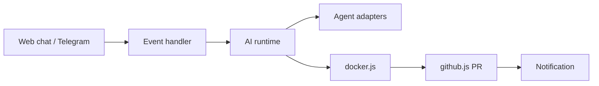

# stephengpope/thepopebot

> Self-hosted personal agent: web and Telegram chat, code workspaces and background tasks that open PRs.

## The problem
Orchestrating a coding agent that works in the background on your repos, with chat, terminal and notifications, takes a lot of assembly.

## What it actually does
An event handler receives your messages (web, Telegram), picks a coding agent (Claude Code, Codex, Gemini, OpenCode, Pi, Kimi) and either answers directly, or creates an `agent-job/<id>` branch, launches a Docker container, opens a PR, auto-merges it and notifies you. Code workspaces with a browser terminal, a separate helper LLM, cron and triggers, SQLite.

## How it is wired


## Trying it
```bash
mkdir my-agent && cd my-agent
npx thepopebot@latest init
npm run setup
```

## Cost and gotchas
LLM keys at your expense (or a Claude subscription token), a GitHub account, Docker and ngrok for a local setup. According to the README, no rate limiting or TLS on the local hop; auto-merge gives the agent high power.

## What it is not
Not a secure turnkey product: the README disclaims responsibility for the infrastructure.

## Alternatives
No alternative named in the README.

## For you
Worth watching: an interesting idea of asynchronous agents working through PRs, but single maintainer, young (2026) and auto-merge needs to be kept in check.
