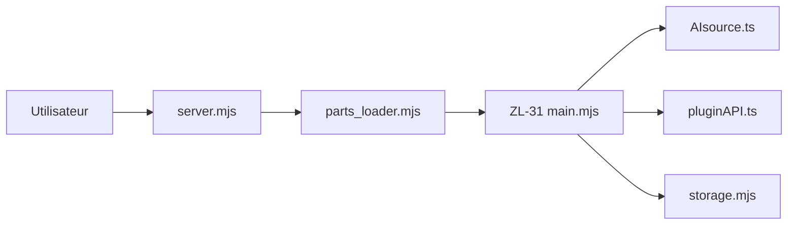

# steve02081504/fount

> Modular AI agent platform to customize through code: characters, worlds, shells and AI sources.

## The problem
LLM chat frontends freeze the agent's logic: you can tune the prompt and the interface, rarely the behavior.

## What it actually does
A Deno/Express server that loads "parts" (chars, worlds, personas, shells, AIsources). The chat resolves a character, builds the prompt, calls an AI source (free-form JS code) then passes the replies through plugins. Code blocks that are sent can be executed live; shells for Telegram, Discord, browser, IDE; P2P on LAN. The default character ZL-31 drives per-conversation configuration.

## How it is wired


## Trying it
```bash
npx the-fount
docker pull ghcr.io/steve02081504/fount
fount remove
```

## Cost and gotchas
You have to configure an LLM API (billing at your expense). Characters run JavaScript: the README warns that community parts may contain malicious code.

## What it is not
Not a simple ready-to-use chat: learning curve and code required to go far. The license is present but not identified by GitHub. Migration of old characters is not supported.

## Alternatives
- OpenClaw: to try agents without deep customization.
- SillyTavern: if you depend on STscript or its plugins.
- ChatGPT: to simply chat.

## For you
Worth watching: running third-party code and the unclear license hold back professional use, but the idea of a programmable agent runtime deserves a look.
