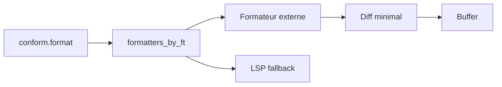

# stevearc/conform.nvim

> Neovim code-formatting plugin that preserves extmarks and folds, for dozens of formatters.

## The problem
Most formatters replace the whole buffer, which breaks extmarks, folds and cursor position.

## What it actually does
Computes minimal diffs and applies them through the native LSP utilities. Does range formatting even when the formatter does not support it, fixes LSP servers that rewrite the whole buffer, and formats injected code blocks (Markdown). A long list of built-in formatters (black, ruff, prettier, stylua, sqlfluff...). Neovim 0.10+ required.

## How it is wired


## Trying it
```lua
{ 'stevearc/conform.nvim', opts = {} }
require("conform").setup({ formatters_by_ft = { lua = { "stylua" }, python = { "isort", "black" } } })
```

## Cost and gotchas
Free; each formatter must be installed separately. FAQ answer: there is no "EslintFixAll" formatter and no code action.

## What it is not
Not a formatter itself: it drives external tools.

## Alternatives
No alternative named in the README (except `vim.lsp.buf.format` as an API model).

## For you
Keep an eye on it: a good choice for formatting Python (ruff, black), SQL and YAML in Neovim, if that is your editor.
