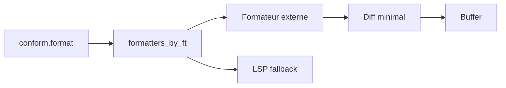

# stevearc/conform.nvim

> Plugin Neovim de formatage de code qui préserve extmarks et plis, pour dizaines de formateurs.

## Le problème
La plupart des formateurs remplacent tout le buffer, ce qui casse extmarks, plis et position du curseur.

## Ce que ça fait vraiment
Calcule des diffs minimaux et les applique via les utilitaires LSP natifs. Fait du formatage par plage même sans support du formateur, corrige les serveurs LSP qui réécrivent tout le buffer, formate les blocs de code injectés (Markdown). Une longue liste de formateurs intégrés (black, ruff, prettier, stylua, sqlfluff...). Neovim 0.10+ requis.

## Comment c'est branché


## Essayer
```lua
{ 'stevearc/conform.nvim', opts = {} }
require("conform").setup({ formatters_by_ft = { lua = { "stylua" }, python = { "isort", "black" } } })
```

## Coût et pièges
Gratuit ; chaque formateur doit être installé séparément. Réponse FAQ : pas de formateur « EslintFixAll » ni de code action.

## Ce que ce n'est pas
Pas un formateur lui-même : il pilote des outils externes.

## Alternatives
Aucune alternative nommée dans le README (sauf `vim.lsp.buf.format` comme modèle d'API).

## Pour toi
Surveiller : bon choix pour formater Python (ruff, black), SQL et YAML dans Neovim, si c'est ton éditeur.

