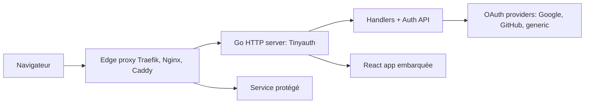

# steveiliop56/tinyauth

> Minimal authentication and authorization server, as middleware in front of your applications or as a standalone server.

## The problem
Protect self-hosted applications behind a reverse proxy without deploying a heavy identity stack.

## What it actually does
Acts as an authentication intermediary for Traefik, Nginx and Caddy, with OAuth, LDAP and access controls. Version 5.1.0 is OpenID certified (Basic OP) according to the README. From the architecture described from the code: a Go HTTP server, an embedded React interface, Google, GitHub and generic providers, TOTP and a user-management CLI. No external database is mentioned by this description.

## How it is wired

## Trying it
No command documented in the README: it points to the online documentation and to a demo `docker-compose` (Traefik, Whoami, Tinyauth). An online demo exists with user `user` and password `password`.

## Cost and gotchas
Free. The README warns that the project is under active development and that the configuration changes often: read the release notes before each update. The compose file lives on the development branch and may be ahead of the stable version. 48 open issues.

## What it is not
It is not a full directory-style identity provider. Nor is it frozen: the configuration changes from one version to the next.

## Alternatives
No alternative named in the README.

## For you
Watch: useful for securing internal MLOps tools behind a proxy, but the configuration is unstable, it is AGPL-3.0 and has a single maintainer; retest once the config stabilizes.
