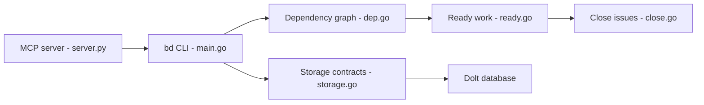

# steveyegge/beads

> Dependency-graph task manager, built on Dolt, serving as persistent memory for coding agents.

## The problem
Agents lose context on long tasks when the plan lives in Markdown files.

## What it actually does
The `bd` CLI creates tasks ("beads") with hash-based identifiers, links dependencies, lists what is unblocked (`bd ready`), lets you claim and close tasks, store memories (`bd remember`) and compact old tasks. Embedded or server Dolt storage; synchronization through Dolt remotes; an MCP server and an HTTP API also exist.

## How it is wired


## Trying it
```bash
curl -fsSL https://raw.githubusercontent.com/gastownhall/beads/main/scripts/install.sh | bash
cd your-project
bd init
bd create "Title" -p 0
bd ready
bd update <id> --claim
bd close <id>
```

## Cost and gotchas
Free. `bd init` modifies `AGENTS.md` and installs Claude/Codex integrations unless you pass `--stealth` or `--skip-agents`. Upgrading: beware of schema migrations on remote databases.

## What it is not
Not a human project management tool like Jira. The data is not in `issues.jsonl`, which is only an export.

## Alternatives
No alternative named in the README.

## For you
Keep an eye on it: useful if you have agents work on long-running efforts, but costly to adopt (Dolt, hooks) and the project depends on one person.
