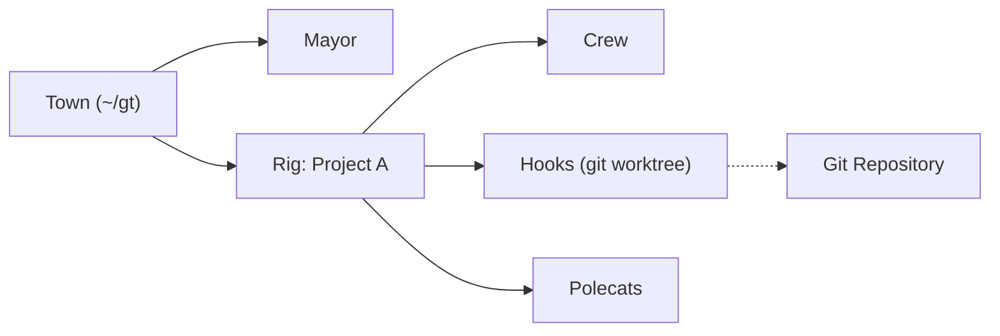

# steveyegge/gastown

> Workspace manager that coordinates many coding agents (Claude Code, Copilot, Codex) with persistent state.

## The problem
When you run several coding agents, context is lost on restart and manual coordination becomes chaotic beyond a few agents.

## What it actually does
- A "Mayor" (a Claude Code instance) receives your requests and creates convoys of tasks (beads) assigned to agents.
- "Polecats" are ephemeral agents with a persistent identity; their state is stored in hooks (git worktrees) and the Beads registry.
- Three-level monitoring (Witness, Deacon, Dogs), a Bors merge queue (Refinery), a concurrency scheduler.
- Web dashboard, `gt feed` TUI stream, OpenTelemetry telemetry, a "Wasteland" network via DoltHub.

## How it is wired


## Trying it
```bash
brew install gastown
gt install ~/gt --shell --git
cd ~/gt
gt up
gt doctor --fix
gt mayor attach
```

## Cost and gotchas
The agents consume your quotas or keys (Claude; Copilot requires a seat); the scheduler exists to avoid exhausting limits. Prerequisites: Git 2.20+, tmux 3.0+, Dolt, bd, Go 1.26.2+ outside Homebrew and Docker. 486 open issues.

## What it is not
Not a coding agent: it orchestrates the ones you install. Not lightweight: many concepts (rigs, convoys, molecules, Wasteland). README truncated in this block, the end on telemetry was not read; no code diagram provided.

## Alternatives
No alternative named in the README read.

## For you
Worth watching: persistent orchestration of agent fleets is a central topic, but the learning curve is steep and the project is young and dense.
