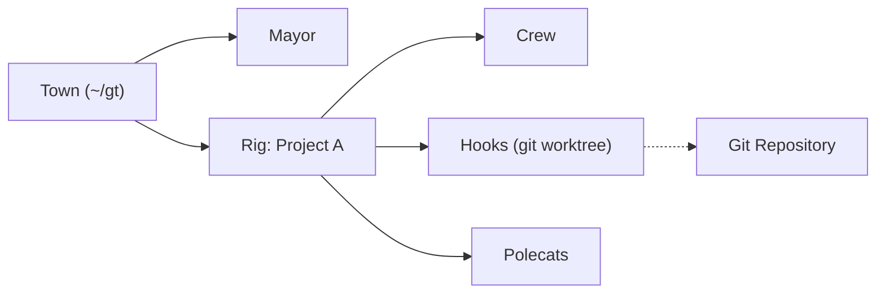

# steveyegge/gastown

> Gestionnaire d'espace de travail qui coordonne de nombreux agents de code (Claude Code, Copilot, Codex) avec un état persistant.

## Le problème
Quand on lance plusieurs agents de code, le contexte se perd au redémarrage et la coordination à la main devient chaotique au-delà de quelques agents.

## Ce que ça fait vraiment
- Un « Mayor » (instance Claude Code) reçoit tes demandes et crée des convoys de tâches (beads) assignées aux agents.
- Les « polecats » sont des agents éphémères à identité persistante ; leur état est stocké dans des hooks (worktrees git) et le registre Beads.
- Surveillance en trois niveaux (Witness, Deacon, Dogs), file de fusion Bors (Refinery), planificateur de concurrence.
- Dashboard web, flux TUI `gt feed`, télémétrie OpenTelemetry, réseau « Wasteland » via DoltHub.

## Comment c'est branché


## Essayer
```bash
brew install gastown
gt install ~/gt --shell --git
cd ~/gt
gt up
gt doctor --fix
gt mayor attach
```

## Coût et pièges
Les agents consomment tes quotas ou clés (Claude, Copilot demande un siège) ; le planificateur sert à éviter l'épuisement des limites. Prérequis : Git 2.20+, tmux 3.0+, Dolt, bd, Go 1.26.2+ hors Homebrew et Docker. 486 issues ouvertes.

## Ce que ce n'est pas
Pas un agent de code : il orchestre ceux que tu installes. Pas léger : beaucoup de concepts (rigs, convoys, molecules, Wasteland). README tronqué dans ce bloc, la fin sur la télémétrie n'a pas été lue ; pas de diagramme du code fourni.

## Alternatives
Aucune alternative nommée dans le README lu.

## Pour toi
À surveiller : l'orchestration persistante de flottes d'agents est un sujet central, mais la courbe d'entrée est raide et le projet est jeune et dense.

