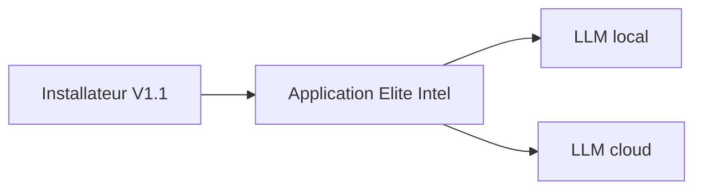

# stone-alex/EliteIntel

> Installable voice assistant for the game Elite, usable offline with a local LLM or online.

## The problem
The README does not say explicitly: the available material is too short to frame the problem.

## What it actually does
An application with Linux and Windows installers, multilingual version 1.1. It runs 100% offline with a local LLM, or with cloud services. The README does not describe the assistant's features.

## How it is wired
Simplified diagram based on the sheet, no diagram provided.

## Trying it
No documented command: the README describes an installer to download and run.

## Cost and gotchas
The local LLM is free but requires a capable graphics card. The cloud LLM is simpler but depends on a third-party service whose price the README does not specify.

## What it is not
Not a library nor a development tool. The game concerned is not named in the README (the repository name suggests it).

## Alternatives
No alternative named in the README.

## For you
Ignore: it is a game application with no link to your work, and the README is too short to judge further.
