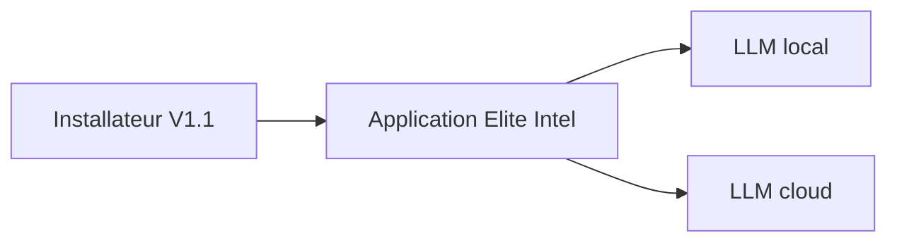

# stone-alex/EliteIntel

> Assistant vocal installable pour le jeu Elite, utilisable hors ligne avec un LLM local ou en ligne.

## Le problème
Le README ne le dit pas explicitement : la matière disponible est trop courte pour cadrer le problème.

## Ce que ça fait vraiment
Une application avec installateurs Linux et Windows, version 1.1 multilingue. Elle fonctionne à 100 % hors ligne avec un LLM local, ou avec des services cloud. Le README ne décrit pas les fonctions de l'assistant.

## Comment c'est branché
Schéma simplifié d'après la fiche, sans diagramme fourni.

## Essayer
Aucune commande documentée : le README décrit un installateur à télécharger et à lancer.

## Coût et pièges
Le LLM local est gratuit mais demande une carte graphique capable. Le LLM cloud est plus simple mais dépend d'un service tiers dont le README ne précise pas le prix.

## Ce que ce n'est pas
Pas une bibliothèque ni un outil de développement. Le jeu concerné n'est pas nommé dans le README (le nom du dépôt le suggère).

## Alternatives
Aucune alternative nommée dans le README.

## Pour toi
À ignorer : c'est une application de jeu sans lien avec ton métier, et le README est trop court pour juger davantage.

