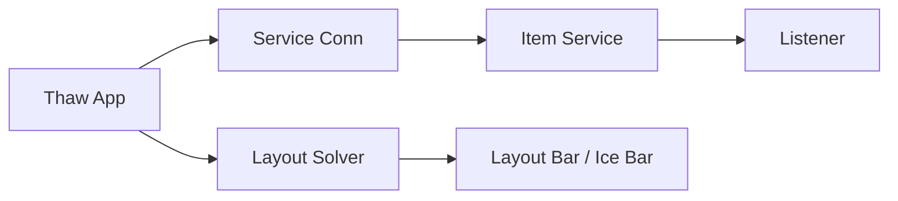

# stonerl/Thaw

> Repository moved: old copy of a macOS menu bar manager.

## The problem
The README only says "This repository has moved to https://github.com/thaw-app/Thaw"; the targeted problem is not documented.

## What it actually does
Based on the code: macOS app that hides, shows and reorders menu bar items, with a helper service `MenuBarItemService`, a layout engine (`LayoutSolver`, `LayoutReconciler`), profiles, shortcuts and hooks.

## How it is wired

## Trying it
No documented command; the README points to `thaw-app/Thaw`.

## Cost and gotchas
No license declared. The living repository is elsewhere.

## What it is not
Not the repository to follow: the README says it has moved.

## Alternatives
- thaw-app/Thaw: current repository indicated by the README.

## For you
Ignore: moved copy, no license, and a convenience macOS tool unrelated to data, AI or MLOps work.
