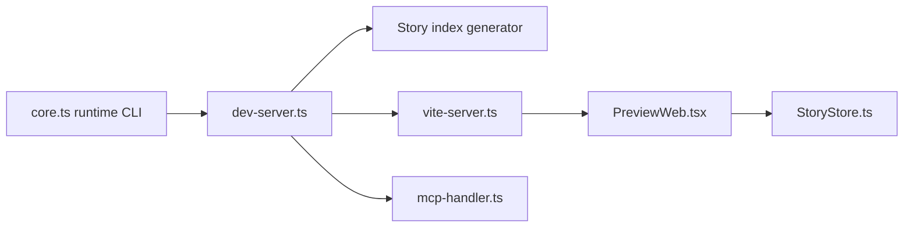

# storybookjs/storybook

> Front-end workshop for building, testing and documenting UI components in isolation.

## The problem
Developing a component inside the full application is slow and hard to test or document.

## What it actually does
A Node server indexes story files (CSF), provides a management interface and a preview iframe linked by a postMessage channel. Vite and Webpack 5 builders, frameworks for React, Angular, Vue, Svelte, Next.js and others, and addons (a11y, docs, Vitest) extend it. An MCP addon exposes components to AI clients. The monorepo uses Yarn 4 and Nx.

## How it is wired


## Trying it
```bash
yarn start
yarn task
yarn lint
yarn test
```

## Cost and gotchas
Free. These commands are for developing the repository itself, not for adding it to a project: see the website. Several older addons need migration.

## What it is not
Not an end-to-end testing tool on its own. Not for data or ML.

## Alternatives
No alternative named in the README.

## For you
Ignore, unless you are building a demo interface for your models: the subject is component design.
