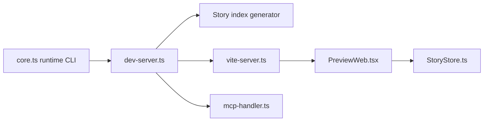

# storybookjs/storybook

> Atelier front-end pour construire, tester et documenter des composants UI en isolation.

## Le problème
Développer un composant dans l'application complète est lent et difficile à tester ou documenter.

## Ce que ça fait vraiment
Un serveur Node indexe les fichiers d'histoires (CSF), fournit une interface de gestion et un iframe de prévisualisation reliés par un canal postMessage. Des constructeurs Vite et Webpack 5, des cadres pour React, Angular, Vue, Svelte, Next.js et d'autres, et des addons (a11y, docs, Vitest) l'étendent. Un addon MCP expose les composants aux clients IA. Le monorepo utilise Yarn 4 et Nx.

## Comment c'est branché


## Essayer
```bash
yarn start
yarn task
yarn lint
yarn test
```

## Coût et pièges
Gratuit. Ces commandes concernent le développement du dépôt lui-même, pas l'ajout à un projet : voir le site. Plusieurs addons anciens sont à migrer.

## Ce que ce n'est pas
Pas un outil de test de bout en bout seul. Pas pour la donnée ou le ML.

## Alternatives
Aucune alternative nommée dans le README.

## Pour toi
À ignorer, sauf si tu construis une interface de démonstration pour tes modèles : le sujet est le design de composants.

