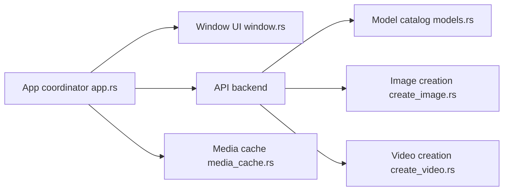

# storytold/artcraft

> Desktop application for creating AI images and videos, with 2D composition and 3D staging.

## The problem
Prompting alone gives little control over composition, character identity and camera placement.

## What it actually does
A desktop app that works as an IDE: you compose in 2D, stage in 3D (posing, kitbashing, image to mesh), then generate with third-party models (images, video, music, 3D, worlds). The README catalog lists a large number of models from external providers. The backend goes through the "ArtCraft API".

## How it is wired

## Trying it
No command documented in the README (Windows and macOS downloads, build from source including Linux).

## Cost and gotchas
The billing model is not documented in the README. Generations depend on external providers and on the ArtCraft API.

## What it is not
Not a standalone local tool: according to the README, the models do not run on your machine. Some integrations (Kling, Google, Runway, Luma) are only planned.

## Alternatives
No alternative named in the README (OpenArt and Freepik are cited as subscriptions to support).

## For you
Worth watching if you do visual generation; little value for data/MLOps work.
