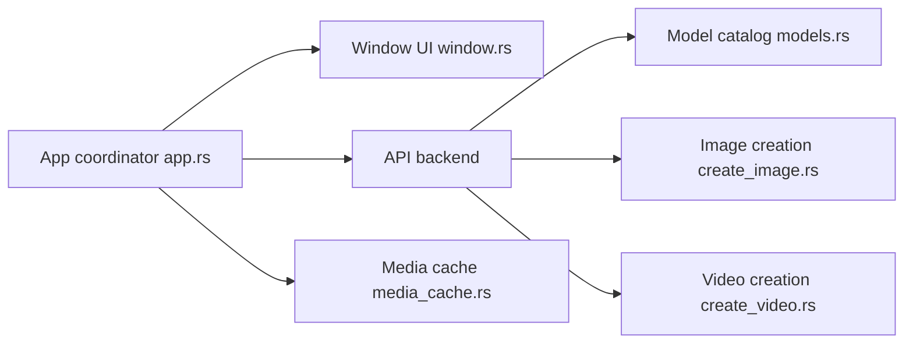

# storytold/artcraft

> Application de bureau pour créer images et vidéos par IA, avec composition 2D et mise en scène 3D.

## Le problème
Le prompting seul donne peu de contrôle sur composition, identité des personnages et placement de caméra.

## Ce que ça fait vraiment
Appli de bureau qui sert d'IDE : on compose en 2D, on met en scène en 3D (posing, kitbashing, image vers mesh), puis on génère avec des modèles tiers (images, vidéo, musique, 3D, mondes). Le catalogue du README compte une grosse liste de modèles de fournisseurs externes. Le backend passe par l'« ArtCraft API ».

## Comment c'est branché

## Essayer
Aucune commande documentée dans le README (téléchargements Windows et macOS, compilation depuis les sources y compris Linux).

## Coût et pièges
Le modèle de facturation n'est pas documenté dans le README. Les générations dépendent de fournisseurs externes et de l'ArtCraft API.

## Ce que ce n'est pas
Pas un outil local autonome : les modèles ne tournent pas sur ta machine d'après le README. Certaines intégrations (Kling, Google, Runway, Luma) sont seulement planifiées.

## Alternatives
Aucune alternative nommée dans le README (OpenArt et Freepik cités comme abonnements à supporter).

## Pour toi
À surveiller si tu fais de la génération visuelle ; peu de valeur pour un travail data/MLOps.

