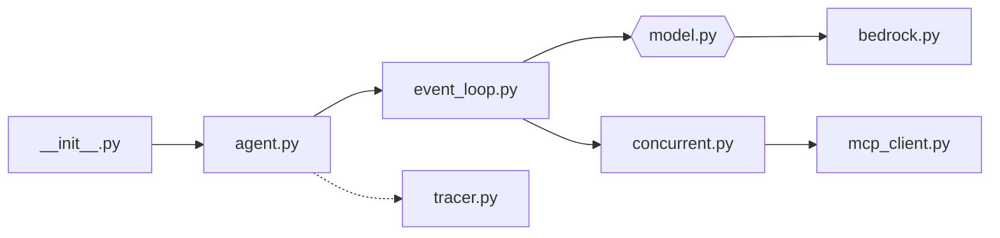

# strands-agents/harness-sdk

> Python and TypeScript SDK for building AI agents without writing your own agent loop.

## The problem
A homemade agent loop grows fast: turn limits, token budgets, cancellation, tools, MCP, memory, traces, multi-agent. Everything gets rewritten by hand.

## What it actually does
Monorepo: Python SDK (`strands-py`), TypeScript SDK (`strands-ts`), a pre-assembled "harness" (`create_harness()`), CLI, documentation site, documentation MCP server.
An `Agent` drives a model/tools loop; providers sit behind a common abstraction (Bedrock by default, Anthropic, OpenAI, Gemini, Ollama...).
Tools run sequentially or concurrently, can be isolated in a local, Docker or SSH sandbox; built-in MCP client.
Hooks and middleware at every step, context management, sessions (files, S3), graphs, swarm, A2A, traces.

## How it is wired


## Trying it
```bash
pip install strands-harness
pip install strands-agents strands-agents-tools
npm install @strands-agents/harness
npm install @strands-agents/sdk
```

## Cost and gotchas
Python 3.10+ or Node.js 22+. The default provider is Amazon Bedrock: without an AWS account, configure another provider. Model calls are at your expense.

## What it is not
Not a hosted platform: everything runs in your process, with no control plane.
Not a finished product: the harness provides defaults, the rest you wire yourself.
Bidirectional audio agents (Gemini Live, Nova Sonic, OpenAI Realtime) remain experimental on the Python side.

## Alternatives
No alternative named in the README.

## For you
Serious candidate if you were about to write your own agent loop in Python, especially on Bedrock; compare before adopting.
