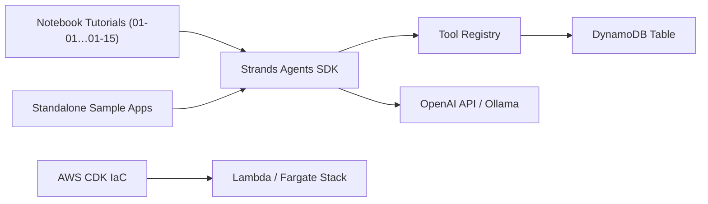

# strands-agents/samples

> Examples and tutorials for building agents with the Strands Agents SDK, in Python and TypeScript.

## The problem
Getting started with an agent SDK is slow without runnable examples or a learning path.

## What it actually does
A demo repository. On the Python side: `01-learn` (basics, multi-agent, streaming), `02-deploy` (Lambda, Fargate, AgentCore), `03-integrate`, `04-industry-use-cases`, `05-technical-use-cases` (agentic RAG), `06-evaluate`, `07-ux-demos`, `08-edge`. On the TypeScript side: `01-learn` and `02-deploy`. Everything depends on the Strands SDK, installed separately.

## How it is wired


## Trying it
```bash
python -m venv venv
source venv/bin/activate
pip install strands-agents strands-agents-tools
npm install @strands-agents/sdk
```

## Cost and gotchas
Python 3.10+ (Node 18+ for TypeScript). You must configure a model provider; the deployment examples assume an AWS account (Lambda, Fargate, DynamoDB), with billing at your expense.

## What it is not
Not production code: the README says so, security and tests must be redone. It is not the SDK itself.

## Alternatives
No alternative cited in the README.

## For you
Worth watching as a library of examples if you are evaluating Strands; of little interest otherwise, since it is only a repository of examples.
