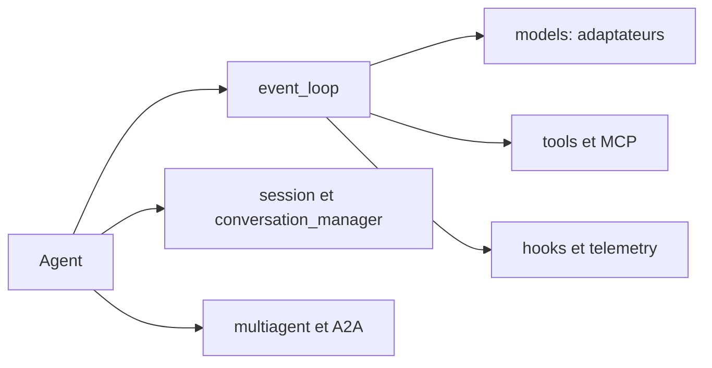

# strands-agents/sdk-python

> Python and TypeScript SDK for building model-driven AI agents, with no hosted control plane.

## The problem
Writing your own agent loop forces you to reinvent turn limits, token budgets, tools, sessions and tracing.

## What it actually does
The agent loop runs in your process: tools and structured output, MCP, multi-agent (graph, swarm, A2A), memory and sessions (file, S3), tracing, guardrails, evaluations. Adapters for Bedrock (default), Anthropic, OpenAI, Gemini, Ollama and others. Experimental modules cover bidirectional streaming and steering.

## How it is wired


## Trying it
```bash
pip install strands-agents strands-agents-tools
```
```python
from strands import Agent
from strands_tools import calculator
agent = Agent(tools=[calculator])
agent("What is the square root of 1764")
```

## Cost and gotchas
The default provider is Amazon Bedrock: AWS credentials and access to Claude Sonnet models must be enabled. Python 3.10+, Node 22+ for the TypeScript SDK.

## What it is not
Not a hosted execution platform. The `experimental/` modules (bidi, steering, checkpoint) have no stable contract.

## Alternatives
No alternative named in the README.

## For you
Adopt: a lean base for Python agents with built-in tracing and free choice of model; license not declared, to be confirmed.
