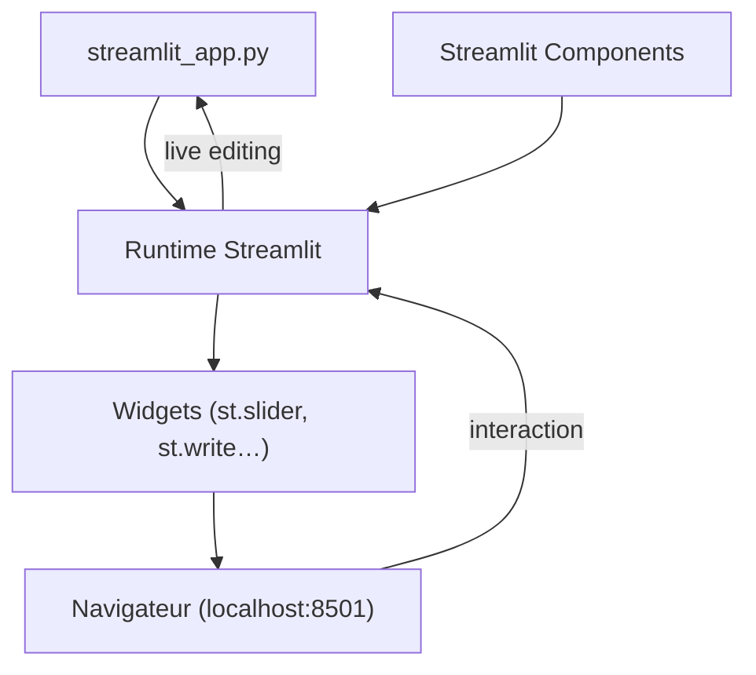

# streamlit/streamlit

> Python library that turns a script into an interactive web app, with no front end.

## The problem
Showing a model or a dataset to someone otherwise means writing HTML and JavaScript
and handling hosting, for a demo that will live two weeks.

## What it actually does
Runs a Python script from top to bottom and renders each `st.*` call as a page element;
the script is re-run on every interaction. Provides input widgets, dataframes, charts,
layout and multi-page apps.
Reloads the app each time the file is saved. Streamlit Components let you
extend the catalog of elements.

## How it is wired


## Trying it
```bash
pip install streamlit
streamlit hello
streamlit run streamlit_app.py
```

## Cost and gotchas
Free. Community Cloud is offered to deploy and share, hosted by the vendor, so
a dependency on a third-party service if you use it. External pull requests are suspended:
you can report bugs, but not contribute code upstream.

## What it is not
It is not a general-purpose web framework: the "re-run the whole script" model bounds what you
can do with it. It is not a tool for putting a model into production, more of a showcase.
It is not a charting library: the charts come from elsewhere.

## Alternatives
No alternative named in the README (only `streamlit-extras`, an extension, is cited).

## For you
The shortest path between a notebook and something a business user can click.
