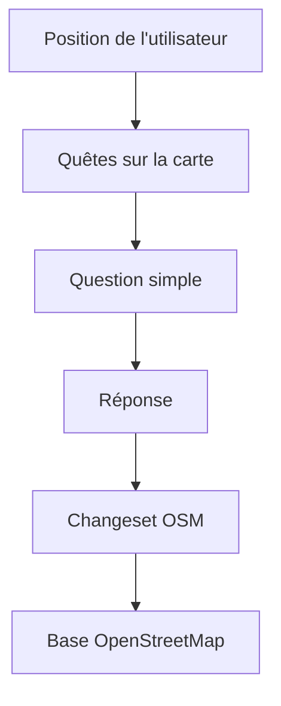

# streetcomplete/StreetComplete

> Mobile app that asks simple questions in the field to enrich OpenStreetMap, without needing to know its vocabulary.

## The problem
Contributing to OpenStreetMap requires knowing its technical tags, which puts off occasional contributors.

## What it actually does
The app (Android and iOS) spots nearby places to check and displays them as "quests" on a map. The user answers a simple question (for example the name of a street), and the answer is sent to the OSM database through an account, in coherent changesets. It works offline and uses little data.

## How it is wired
Simplified diagram based on the sheet, no diagram provided.



## Trying it
```bash
# Aucune commande : la section Download du README est vide, installer l'application depuis un magasin
```

## Cost and gotchas
Free (GPL-3.0, copyleft). An OpenStreetMap account is needed to send the answers.

## What it is not
Not a full OSM editor: quests are limited to simple questions. Not a data analysis tool.

## Alternatives
No alternative cited in the README.

## For you
Ignore: useful for mapping the field, but unrelated to data, AI or MLOps pipelines.
