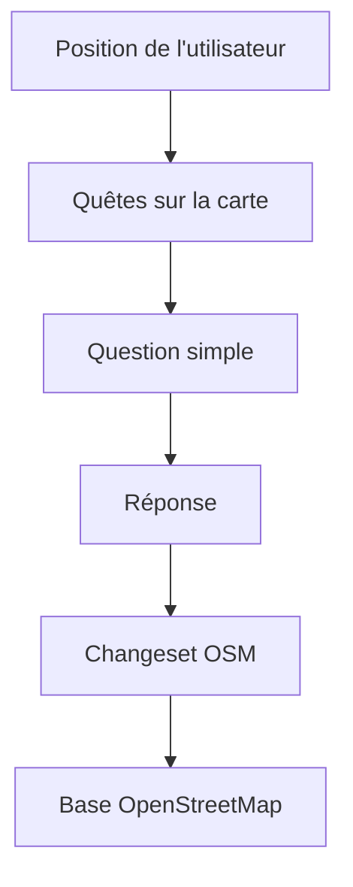

# streetcomplete/StreetComplete

> Application mobile qui pose des questions simples sur le terrain pour enrichir OpenStreetMap, sans connaître son vocabulaire.

## Le problème
Contribuer à OpenStreetMap exige de connaître ses balises techniques, ce qui éloigne les contributeurs occasionnels.

## Ce que ça fait vraiment
L'application (Android et iOS) repère à proximité les lieux à vérifier et les affiche en « quêtes » sur une carte. L'utilisateur répond à une question simple (par exemple le nom d'une rue), et la réponse est envoyée dans la base OSM via un compte, par jeux de modifications cohérents. Elle fonctionne hors ligne et consomme peu de données.

## Comment c'est branché
Schéma simplifié d'après la fiche, sans diagramme fourni.



## Essayer
```bash
# Aucune commande : la section Download du README est vide, installer l'application depuis un magasin
```

## Coût et pièges
Gratuit (GPL-3.0, copyleft). Un compte OpenStreetMap est nécessaire pour envoyer les réponses.

## Ce que ce n'est pas
Pas un éditeur OSM complet : les quêtes se limitent à des questions simples. Pas un outil d'analyse de données.

## Alternatives
Aucune alternative citée dans le README.

## Pour toi
À ignorer : utile pour cartographier le terrain, mais sans rapport avec les pipelines data, IA ou MLOps.

