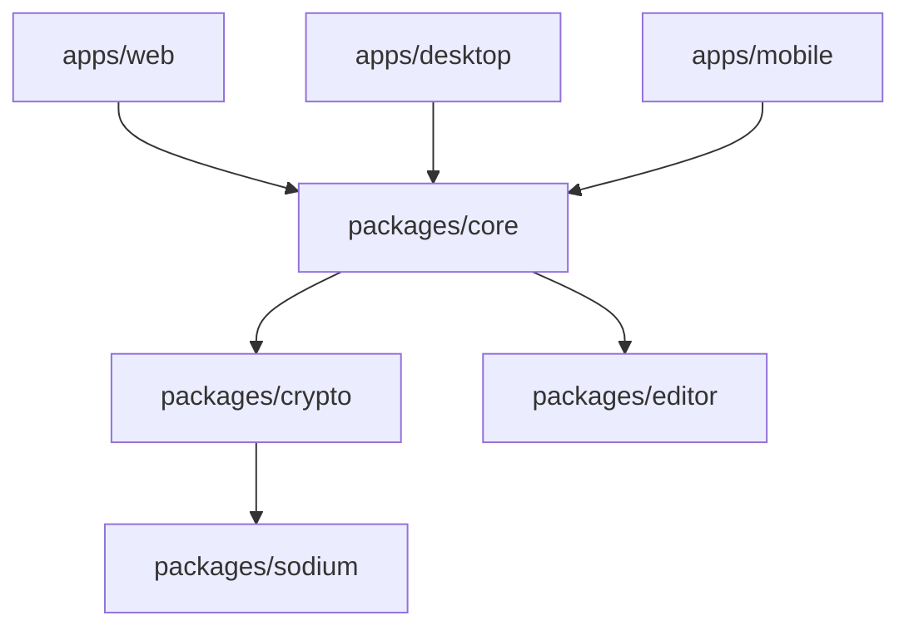

# streetwriters/notesnook

> Open-source, end-to-end encrypted note-taking app, an alternative to Evernote.

## The problem
Mainstream note apps read your content on the server side. Notesnook encrypts on the device before syncing.

## What it actually does
Web, desktop (Electron) and mobile (React Native) clients sharing a common core. Encryption uses XChaCha20-Poly1305 and Argon2, through a libsodium wrapper. It also includes a web clipper and an editor. The repo is an npm monorepo; each project has its own architecture details.

## How it is wired


## Trying it
```bash
# aucune commande dans le README ; voir la documentation de chaque projet du monorepo
```

## Cost and gotchas
The clients are free; the README does not detail the paid plans. An email address is required (justification in the "Why Notesnook requires an email address" link).

## What it is not
Not a standalone server repo according to the README: it covers the clients. Not a knowledge-management tool for data teams.

## Alternatives
Evernote is the reference the tool cites as the one it replaces.

## For you
Skip it for your work: a personal note app, unrelated to data or MLOps, useful only as a personal encrypted tool.
