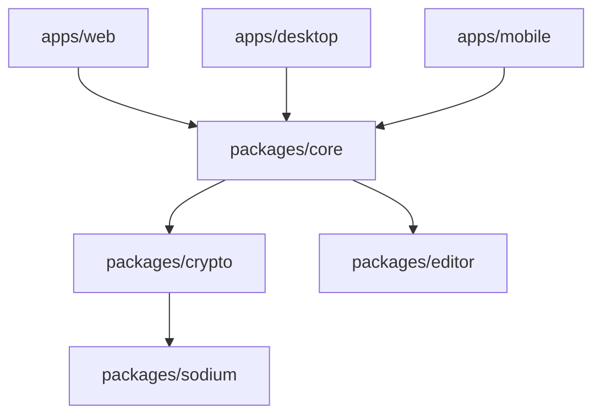

# streetwriters/notesnook

> Application de notes open source chiffrée de bout en bout, alternative à Evernote.

## Le problème
Les apps de notes grand public lisent le contenu côté serveur. Notesnook chiffre sur l'appareil avant synchronisation.

## Ce que ça fait vraiment
Clients web, bureau (Electron) et mobile (React Native) partageant un noyau. Le chiffrement utilise XChaCha20-Poly1305 et Argon2, via une enveloppe libsodium. Contient aussi un clipper web et un éditeur. Le dépôt est un monorepo npm ; chaque projet a ses propres détails d'architecture.

## Comment c'est branché


## Essayer
```bash
# aucune commande dans le README ; voir la documentation de chaque projet du monorepo
```

## Coût et pièges
Les clients sont gratuits ; le README ne détaille pas les offres payantes. Une adresse e-mail est exigée (justification dans le lien « Why Notesnook requires an email address »).

## Ce que ce n'est pas
Pas un dépôt de serveur autonome selon le README : il couvre les clients. Pas un outil de gestion de connaissances pour équipes data.

## Alternatives
Evernote est la référence citée que l'outil remplace.

## Pour toi
À ignorer pour ton travail : app de notes personnelle, sans lien avec data ou MLOps, utile seulement comme outil perso chiffré.

