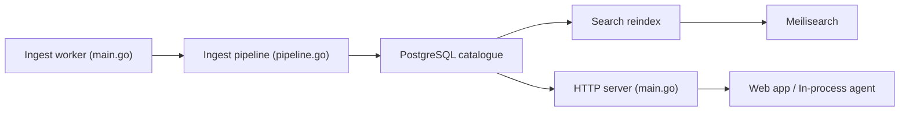

# strelov1/freehire

> Open catalogue of IT job offers crawled from career sites, with CV builder, application tracking and an agent.

## The problem
Job offers are duplicated, republished by intermediaries and often out of date.

## What it actually does
One-shot Go workers crawl 225 sources (ATS such as Workday or Greenhouse, aggregators, career sites) and normalise the offers into Postgres with deduplication; Meilisearch provides faceted search. On top of that: CV builder, CV / offer score, LLM analysis, application board, linked mailbox, agent, public API with no key, CLI, MCP server and Chrome extension.

## How it is wired


## Trying it
```bash
make up
curl localhost:8080/health
curl localhost:8080/api/v1/jobs
go run ./cmd/ingest greenhouse
```

## Cost and gotchas
Heavy stack: api, web, postgres, meilisearch, redis, minio. `JWT_SECRET` is mandatory. The AI features need an LLM endpoint at your own expense. The figures (3.3 M offers) are those of the hosted site, not of your instance.

## What it is not
Not a source guaranteed to be duplicate-free: quality depends on the adapters and the facet dictionaries. Crawling third-party sites falls under their terms of use, which are not discussed.

## Alternatives
No alternative cited in the README.

## For you
Worth watching: the keyless public API and the Go ingestion pipeline can serve as a source of job data or as an example pipeline, but the project is run by a single person.
