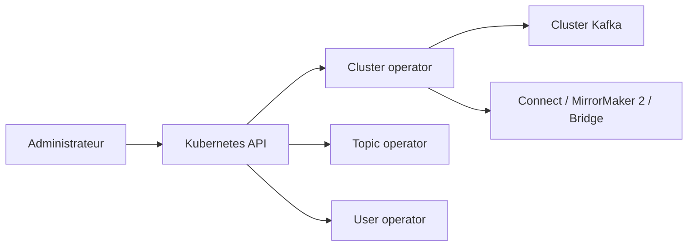

# strimzi/strimzi-kafka-operator

> Operator that deploys and manages Apache Kafka on Kubernetes and OpenShift, for platform teams.

## The problem
Running a Kafka cluster by hand on Kubernetes (brokers, topics, users, upgrades) is heavy and error-prone.

## What it actually does
You declare Kafka as custom resources; the cluster operator reconciles the resources, while the topic operator and the user operator manage topics and credentials. The API models also cover Connect, MirrorMaker 2, Bridge and rebalancing. Containers and SBOMs are signed with cosign. A CNCF incubating project.

## How it is wired


## Trying it
```bash
cosign verify --certificate-identity-regexp='https://github.com/strimzi/.*' \
    --certificate-oidc-issuer='https://token.actions.githubusercontent.com' \
    quay.io/strimzi/operator:latest
```

## Cost and gotchas
Free, but you need a Kubernetes or OpenShift cluster. Signed commits (DCO) are required to contribute.

## What it is not
Not a managed Kafka: you remain responsible for operating the cluster.

## Alternatives
No alternative named in the README.

## For you
Worth watching: relevant for streaming data pipelines on Kubernetes, useless without Kafka.
