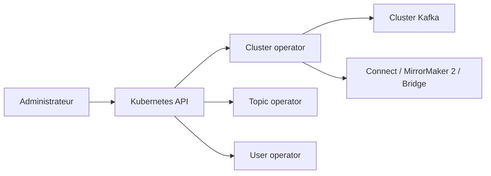

# strimzi/strimzi-kafka-operator

> Opérateur qui déploie et gère Apache Kafka sur Kubernetes et OpenShift, pour équipes plateforme.

## Le problème
Exploiter un cluster Kafka à la main sur Kubernetes (brokers, topics, utilisateurs, mises à jour) est lourd et sujet aux erreurs.

## Ce que ça fait vraiment
Tu déclares Kafka en ressources personnalisées ; le cluster operator réconcilie les ressources, le topic operator et le user operator gèrent topics et identifiants. Les modèles d'API couvrent aussi Connect, MirrorMaker 2, Bridge et le rééquilibrage. Les conteneurs et SBOM sont signés avec cosign. Projet incubé à la CNCF.

## Comment c'est branché


## Essayer
```bash
cosign verify --certificate-identity-regexp='https://github.com/strimzi/.*' \
    --certificate-oidc-issuer='https://token.actions.githubusercontent.com' \
    quay.io/strimzi/operator:latest
```

## Coût et pièges
Gratuit, mais il faut un cluster Kubernetes ou OpenShift. Commits signés (DCO) exigés pour contribuer.

## Ce que ce n'est pas
Pas un Kafka géré : tu restes responsable de l'exploitation du cluster.

## Alternatives
Aucune alternative nommée dans le README.

## Pour toi
À surveiller : pertinent pour des pipelines de données en streaming sur Kubernetes, inutile sans Kafka.

